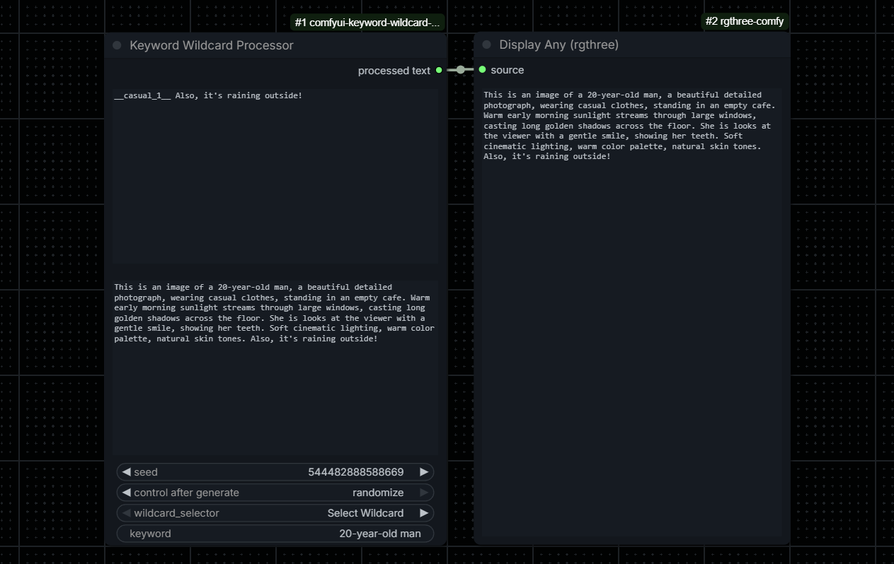

<div align="center">

# ComfyUI Keyword Wildcard Processor
**Custom node for Wildcard.**


</div>

A custom node for ComfyUI that processes Wildcards through the ComfyUI Impact Pack engine and adds a reusable `<keyword>` placeholder to Wildcard templates.

It is useful when the scene should remain inside a Wildcard file while a specific subject, age, outfit, product, character description, or other variable is supplied directly in the Workflow.

## Features
- Uses the same `impact.wildcards.process` engine as the Impact Pack.
- Accepts regular text, `__wildcards__`, or both in the same prompt.
- Replaces every `<keyword>` occurrence after Wildcard expansion.
- Provides a read-only preview of the final processed prompt.
- Supports ComfyUI's native seed controls: `fixed`, `randomize`, `increment`, and `decrement`.
- Automatically discovers the Impact Pack `custom_wildcards` directory.
- Includes a Wildcard selector that inserts `__wildcard_name__` into the prompt field.
- Supports Wildcard files inside nested folders.
- Requires no additional Python packages.

## Requirements
- [ComfyUI](https://github.com/comfyanonymous/ComfyUI).
- [ComfyUI Impact Pack](https://github.com/ltdrdata/ComfyUI-Impact-Pack).

This node depends on the Impact Pack Wildcard engine. It does not implement a separate Wildcard parser.

## Installation

### Git
Open a terminal inside the ComfyUI `custom_nodes` directory and clone the repository:

```bash
cd ComfyUI/custom_nodes
git clone https://github.com/VictorDmAlves/comfyui-keyword-wildcard-processor
```

### ZIP
1. Download the repository as a ZIP file.
2. Extract it into `ComfyUI/custom_nodes/`.
3. Make sure the final structure is not nested twice.

Correct:

```text
ComfyUI/
└── custom_nodes/
    └── comfyui-keyword-wildcard-processor/
        ├── __init__.py
        ├── keyword_wildcard_processor.py
		├── LICENSE
		├── README.md
		├── __pycache__
		├── examples/
		├── images/
        └── web/
```

Restart ComfyUI after installation. The node is available at:

```text
Wildcards → Keyword Wildcard Processor
```

## Quick start
Create a Wildcard file in the Impact Pack Wildcard directory:

```text
ComfyUI/custom_nodes/comfyui-impact-pack/custom_wildcards/casual_cafe.txt
```

Add one prompt option per line. For example:

```text
This is an image of a <keyword>, a beautiful detailed photograph, standing in an empty cafe. Warm early morning sunlight streams through large windows, casting long golden shadows across the floor. The person looks directly at the viewer with a warm smile, showing teeth. Soft cinematic lighting, warm color palette, natural skin tones.
```

Configure the node:

```text
prompt:  __casual_cafe__
keyword: 20-year-old man
```

Processed result:

```text
This is an image of a 20-year-old man, a beautiful detailed photograph, standing in an empty cafe. Warm early morning sunlight streams through large windows, casting long golden shadows across the floor. The person looks directly at the viewer with a warm smile, showing teeth. Soft cinematic lighting, warm color palette, natural skin tones.
```

Connect the `processed text` output to any node that accepts a `STRING`, such as a text-encoding or prompt-processing node.

## Node fields
| Field | Description |
|---|---|
| `prompt` | Free-form prompt. It can contain plain text, one or more `__wildcards__`, or no Wildcard at all. |
| `processed_text` | Read-only preview of the final text produced during the latest execution. |
| `seed` | Seed passed to the Impact Pack Wildcard engine. |
| `control_after_generate` | Native ComfyUI seed behavior: `fixed`, `randomize`, `increment`, or `decrement`. |
| `wildcard_selector` | Lists `.txt` files from the Impact Pack `custom_wildcards` directory and inserts the selected token into `prompt`. |
| `keyword` | Text used to replace every `<keyword>` occurrence after Wildcard processing. Leading and trailing spaces are removed. |

## Wildcard syntax
A Wildcard is referenced by its file name between two pairs of underscores:

```text
__casual_cafe__
```

For this file:

```text
custom_wildcards/casual_cafe.txt
```

Each non-empty line in the file can be selected by the Impact Pack Wildcard engine according to the current seed.

Nested folders are supported. For example:

```text
custom_wildcards/people/casual_cafe.txt
```

File names are normalized in the same style used by the Impact Pack: spaces become hyphens and names are displayed in lowercase.

## Keyword templates
The replacement is case-insensitive, so `<keyword>`, `<KEYWORD>`, and `<Keyword>` are treated as the same placeholder.

Every occurrence is replaced:

```text
A <keyword> standing beside another <keyword>.
```

With:

```text
keyword: red robot
```

Result:

```text
A red robot standing beside another red robot.
```

When the `keyword` field is empty, the replacement step is skipped. A literal `<keyword>` already present in the prompt therefore remains unchanged.

## Seed behavior
The node exposes the standard ComfyUI seed control attached to the `seed` field.

| Mode | Behavior |
|---|---|
| `fixed` | Keeps the current seed after generation. |
| `randomize` | Chooses a new seed for the next generation. |
| `increment` | Adds one to the seed after generation. |
| `decrement` | Subtracts one from the seed after generation. |

The selected Wildcard line is determined by the Impact Pack engine using this seed.

## Wildcard selector
The selector searches for the Impact Pack installation instead of assuming a fixed ComfyUI path. It checks the configured `custom_wildcards` directory and compatible Impact Pack installations found under `custom_nodes`.

After adding, renaming, or moving wildcard files, reload the ComfyUI page or restart ComfyUI. When necessary, also use **Impact: Refresh Wildcard** from the ComfyUI Edit menu.

## Plain prompts
Wildcards are optional. The node also works as a normal prompt processor:

A prompt without Wildcards and without `<keyword>` passes through the Impact Pack processor normally.

## Tip: multiple runs with random Wildcards
If you want to get a different random prompt on every image, prefer **increasing the number of queue runs** over increasing `batch_size`.

- `batch_size > 1` generates several images **in the same execution**, which means the Wildcard node is processed only **once** and the same resolved prompt/seed is reused for the whole batch.
- Queuing the same Workflow multiple times (batch_size = 1, queue count > 1) makes the Wildcard node re-run on **every queue item**, producing a new random prompt and a new seed each time - which is what actually gives you varied results.

## Troubleshooting

### The node does not appear
- Confirm that the folder is directly inside `ComfyUI/custom_nodes/`.
- Check that the folder contains `__init__.py`.
- Restart ComfyUI completely.
- Review the terminal output for import errors.

### The selector is empty
- Confirm that ComfyUI Impact Pack is installed and enabled.
- Confirm that Wildcard files use the `.txt` extension.
- Place them in the Impact Pack `custom_wildcards` directory.
- Reload the page or restart ComfyUI.
- Run **Impact: Refresh Wildcard** when the Impact Pack has cached an older list.

### `<keyword>` appears in the final prompt
- Fill in the `keyword` field.
- Confirm that the template uses `<keyword>` with angle brackets.
- Remember that an empty keyword intentionally skips replacement.

### The processed preview does not update
The `processed_text` field updates after the node executes. Queue the Workflow and confirm that the node is part of the executed graph.

## Updating
From the custom node directory:

```bash
cd ComfyUI/custom_nodes/comfyui-keyword-wildcard-processor
git pull
```

Restart ComfyUI after updating.

## Compatibility note
This project calls the Impact Pack's internal `impact.wildcards.process` function to preserve its Wildcard behavior. A future Impact Pack update that changes that internal API may require a corresponding update to this node.

## Acknowledgements
This project relies on the Wildcard processing engine provided by ComfyUI Impact Pack. ComfyUI and ComfyUI Impact Pack are separate projects owned and maintained by their respective contributors.

## Contributing
Bug reports and pull requests are welcome. When reporting a problem, include:
- ComfyUI version or commit
- ComfyUI Impact Pack version or commit
- Operating system
- Relevant terminal error output
- A minimal wildcard file and Workflow that reproduce the issue

## License
See [LICENSE](LICENSE).